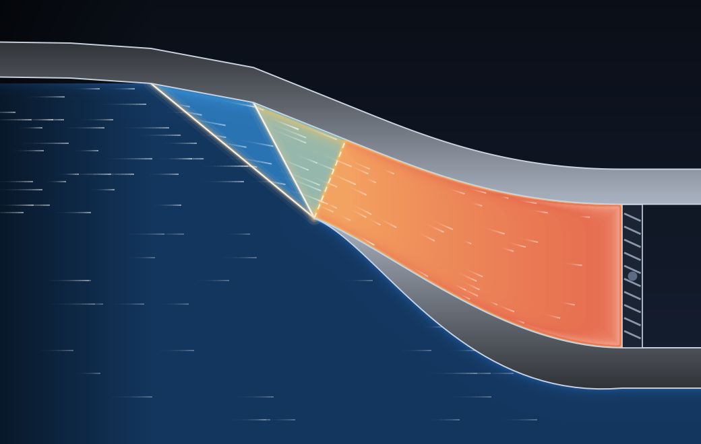
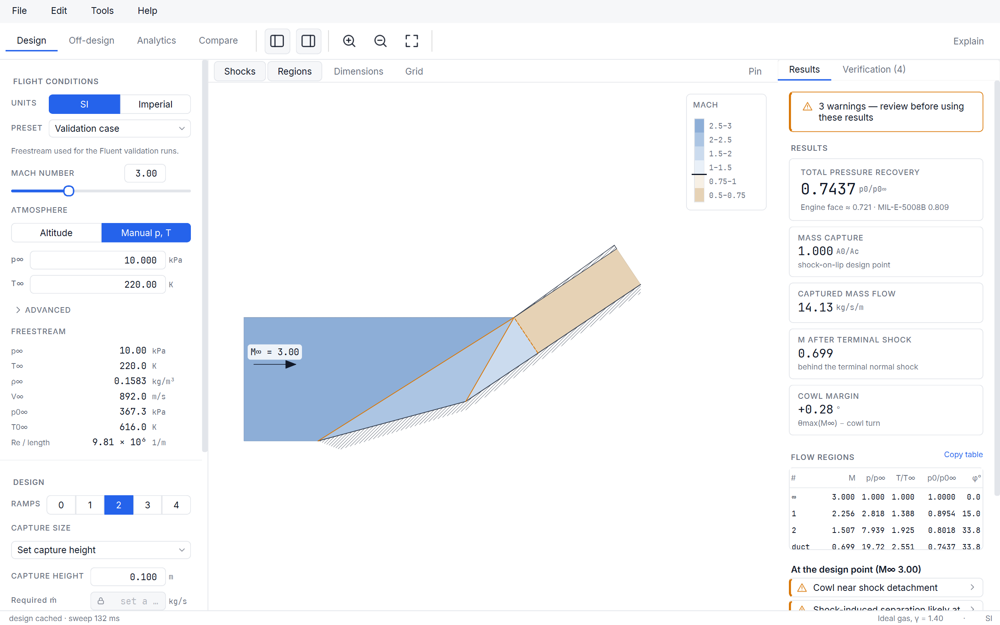
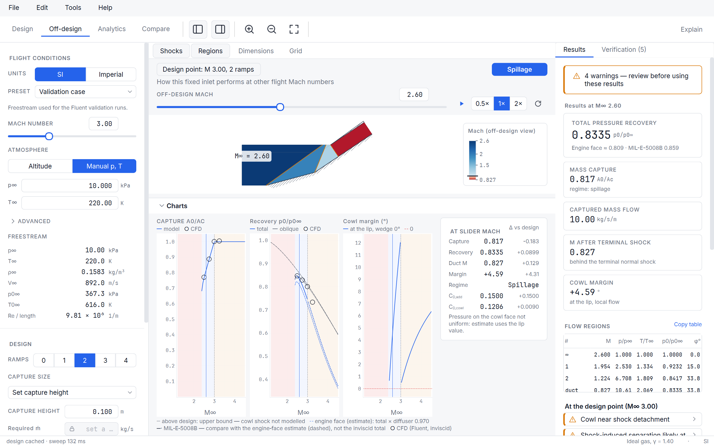
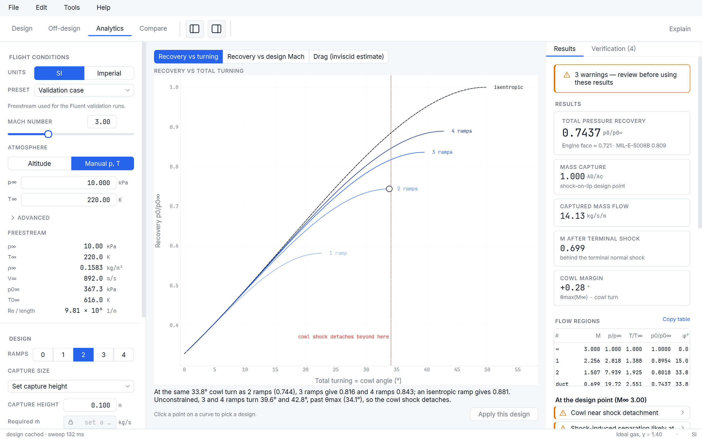
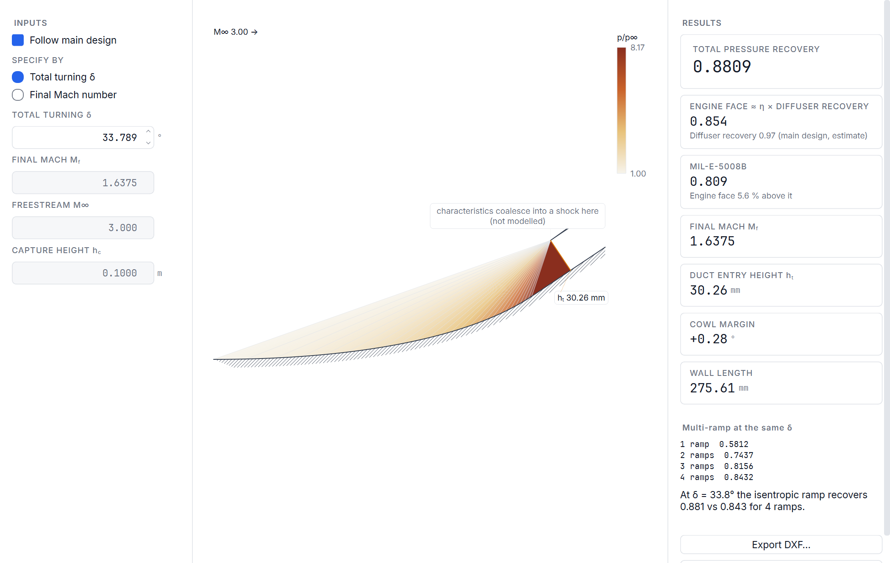

<p align="center">
  
</p>

<p align="center">
  <b>Design two-dimensional supersonic inlets, see their shocks, and know what to check with CFD.</b>
</p>

<p align="center">
  
</p>

## Download

**[Download the latest release](https://github.com/Eski4239/Busemann/releases/latest)**: the
installer (`Busemann-Setup-<version>.exe`, per-user, no administrator rights needed) or the
portable zip. Checksums are in `SHA256SUMS.txt` on the release page.

System requirements: Windows 10/11 64-bit, ~250 MB disk.

- The installer is not code-signed, so Windows SmartScreen may warn on first run: choose
  **More info → Run anyway**.
- The first launch can take up to a minute while Windows scans the new files.

## Features

- **Design.** The Oswatitsch equal-strength optimum for 1–4 ramps (maximum total-pressure
  recovery) or your own ramp angles; flight conditions from altitude or pressure and
  temperature, in SI or imperial units; capture height set directly or sized to an engine's
  mass flow. Drag the ramp corners on the canvas and watch recovery change live.
- **Off-design.** The same fixed inlet at any flight Mach number: spillage, shock-in-duct,
  cowl-shock attachment, recovery against MIL-E-5008B, with a Mach sweep you can play.
- **Analytics.** Trade studies against total turning and design Mach, and inviscid drag
  estimates.
- **Compare.** Pin a design and compare it with the live one, drawing and numbers side by side.
- **Isentropic ramp.** The centred Prandtl–Meyer compression surface for the same turning,
  with its exact pressure field.
- **Explain and Verification.** Every relation with its source and this case's numbers; every
  approximation listed with its criterion and a reminder to verify with CFD.
- **Files.** Designs saved as DXF drawings; geometry, CFD-domain (DXF, Gmsh .geo) and results
  (JSON, CSV) exports, each geometry export with verification notes.









## How it works

Busemann treats the inlet as steady, inviscid, two-dimensional flow of a calorically perfect
gas: a chain of straight oblique ramp shocks that meet at the cowl lip at the design Mach
number, followed by a terminal normal shock at the throat. Every shock, isentropic and
Prandtl–Meyer relation follows NACA Report 1135 (*Equations, Tables, and Charts for
Compressible Flow*), and the optimum ramp angles use the equal-strength condition of
K. Oswatitsch, NACA TM 1140 (*Pressure Recovery for Missiles with Reaction Propulsion at High
Supersonic Speeds*, 1947, translation of the 1944 report): recovery is highest when every
oblique shock has the same normal Mach number. Off design the geometry is frozen and the
shocks move; separation and buzz are flagged with published empirical criteria, labelled
approximate.

## Validation

How it was checked: every relation in the solver follows NACA Report 1135, and an automated test suite of over 1,000 tests checks the results against closed-form values. The designs were also compared with 2D CFD simulations in Ansys Fluent (density-based solver, inviscid and k-ω SST viscous runs, with a mesh-refinement check). At the design point the total-pressure recovery agreed within 0.35%, and below the design Mach within 0.1%, with mass capture within 0.4%. With boundary layers included, recovery was about 2% lower, mainly because of a separation bubble at the second ramp corner, which Busemann's separation warning flags. Above the design Mach the CFD showed a Mach reflection at the cowl lip that this model does not include, so recovery there is an upper bound (the CFD was 4.9% lower at Mach 3.25).

Maximum recoveries agree with Oswatitsch's 1944 results (NACA TM 1140, Fig. 1).

## Build from source

Python 3.11 or newer (the release build uses 3.14).

```powershell
python -m venv .venv
.venv\Scripts\activate
pip install -e ".[app,dev]"
busemann                      # the desktop app
busemann --self-test          # checks an installation without opening a window
```

The physics core (`inletdesign`) runs without Qt; its command-line tool designs an inlet or
sweeps recovery against Mach:

```powershell
inletdesign design --mach 3.0 --ramps 2 --out results/m3_2r
inletdesign curve --ramps 0 1 2 3 --mach-min 1.5 --mach-max 4.0 --step 0.1 --out results/curve
```

Windows installer and portable zip (needs [Inno Setup 6](https://jrsoftware.org/isinfo.php)):

```powershell
powershell -ExecutionPolicy Bypass -File tools\build_release.ps1 -Python C:\Python314\python.exe
```

It builds in a clean venv from the pinned `packaging/requirements-build.txt`, runs the frozen
self-test, and writes `dist\Busemann-Setup-<version>.exe`, the portable zip and
`SHA256SUMS.txt`. Pushing a tag `v<version>` runs the same build on GitHub Actions and
publishes the release.

A local copy of NACA Report 1135 is kept in `references/` for development but is not
committed; it is available from [NASA NTRS](https://ntrs.nasa.gov/citations/19930091059).

### Running tests

Plain `pytest` runs a fast local default: the physics/CLI core plus the GUI tests that check
program correctness (threading, undo, file round-trips, validated numbers). GUI tests that only
check what a user sees immediately (label text, pixel geometry, styling) are marked
`@pytest.mark.ui` and skipped locally by default, same as the `perf`-marked timing tests. To run
everything, matching CI:

```powershell
pytest -m "not perf"   # everything except timing-sensitive perf tests
pytest -m ""            # literally everything
```

## Licence

Busemann is released under the [MIT License](LICENSE). The Windows build bundles third-party
components under their own licences (Qt / PySide6 under LGPLv3, NumPy, SciPy, Matplotlib,
pyqtgraph, ezdxf, the Inter and JetBrains Mono fonts, Python, the PyInstaller bootloader);
they are listed in `THIRD-PARTY-NOTICES.txt` in the install folder and under
Help ▸ About Busemann ▸ Licences.
